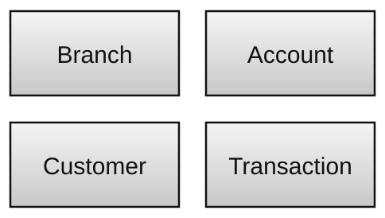
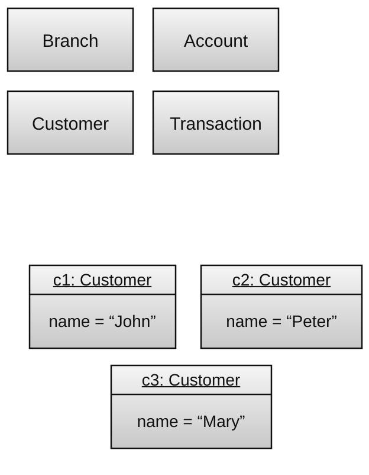
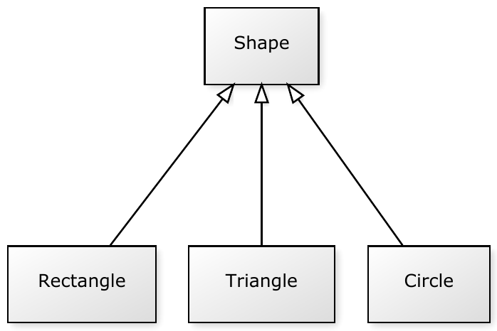
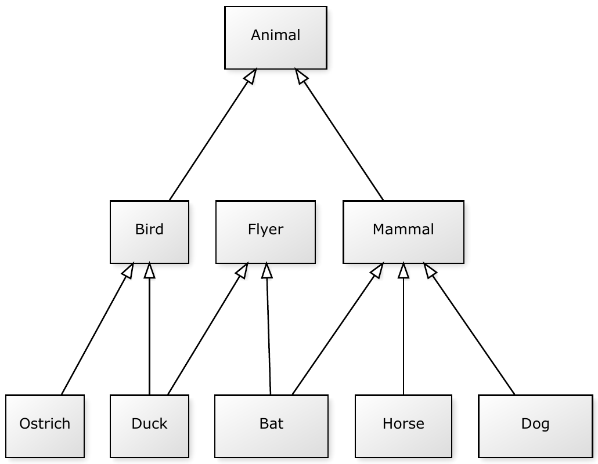

La programación estructurada ofrece mecanismos para modularizar los conceptos de un sistema de software mediante estructuras de datos y los algoritmos que las manipulan. Los lenguajes estructurados más comunes permiten representar distintos tipos de datos y variables para expresar las características y propiedades de esos conceptos, así como procedimientos y funciones para modelar las operaciones correspondientes.

Sin embargo, al intentar reutilizar componentes escritos en lenguajes estructurados, hay que descubrir la relación entre los datos —representados mediante estructuras, tipos de datos y variables— y el comportamiento —expresado mediante procedimientos y funciones—. Por eso, la reutilización suele producirse con granularidad fina y puede exigir un esfuerzo considerable; por ejemplo, para determinar qué procedimientos y funciones se relacionan con cada estructura de datos. Aunque se pueden definir bibliotecas reutilizables, la relación entre los datos y el comportamiento no queda explícita ni se concentra en una sola abstracción.

La **programación orientada a objetos** (POO) es un paradigma que representa los conceptos de un dominio de aplicación mediante tipos abstractos de datos llamados clases. Estas modelan tanto las características y propiedades de esos conceptos como sus operaciones. La POO amplía la programación estructurada al proporcionar medios para especificar clases y combinarlas con el fin de modelar sistemas computacionales completos, buscando mayor modularidad y reutilización de componentes.

Hoy, la orientación a objetos es uno de los paradigmas más aceptados y utilizados para desarrollar software. Muchos lenguajes modernos la admiten, entre ellos Java, C++, C#, Python, Kotlin, JavaScript, TypeScript, Swift y Ruby.

Una **clase** es un mecanismo de abstracción que representa conceptos de un dominio de aplicación. En un dominio bancario, por ejemplo, los conceptos pueden incluir sucursales, cuentas, clientes y transacciones. Podríamos definir las clases `Branch`, `Account`, `Customer` y `Transaction` para representarlos. La figura muestra una representación gráfica de estas clases.

Las clases sirven como *plantillas* para crear ejemplares concretos y manipulables de esos conceptos. Dichos ejemplares se llaman **objetos**. Un objeto es una **instancia** de una clase, y el proceso de crear objetos se denomina **instanciación**. Por ejemplo, podríamos crear objetos para representar a los clientes *John*, *Peter* y *Mary*, junto con su información personal y las funciones disponibles para los clientes.

Una clase se define para representar las propiedades, características y comportamiento de un concepto. Los dos mecanismos principales para ello son los atributos y los métodos.

Los **atributos** representan características o propiedades de los objetos de una clase. Algunos atributos de `Customer` podrían ser *name*, *age*, *address* y *marital status*. Cada cliente concreto puede tener valores distintos. Por ejemplo, un objeto podría tener *name* $`=`$ John Smith, *age* $`=`$ 50, *address* $`=`$ 205 President Vargas Street y *marital status* $`=`$ married.

Los **métodos** representan comportamiento. Algunos métodos de `Account` podrían corresponder a las operaciones de *abrir*, *cerrar* o *cambiar el titular* de una cuenta. **Invocar** un método (también llamado **llamar** a un método) ejecuta la operación que este implementa. Es habitual que las clases tengan métodos especiales para crear (instanciar) objetos, llamados **constructores**, y para destruirlos, llamados **destructores**.

Los atributos y métodos también se dividen en dos categorías: de instancia y de clase. Los **atributos y métodos de instancia** son los más habituales y se acceden a través de los objetos de la clase. Representan características y operaciones asociadas con cada instancia. Algunos atributos de instancia de `Account` serían *bank*, *branch*, *account number* y *account holder*; algunos métodos de instancia serían *withdraw*, *transfer* y *deposit*. En cambio, los **atributos y métodos de clase** pertenecen a la clase, no a sus instancias. Por ejemplo, un atributo de clase podría contar cuántas instancias de `Account` se han creado y un método de clase podría obtener ese número.

Para restringir el acceso a los atributos y métodos, las clases ofrecen mecanismos de **encapsulación y ocultación de información**. Los lenguajes de programación suelen proporcionar modificadores de visibilidad que especifican quién puede acceder a un atributo, método o clase.

Las clases abstraen y encapsulan conceptos del mundo real y del mundo computacional. Estas abstracciones se combinan mediante relaciones para que las clases colaboren y cumplan los requisitos de una aplicación. Entre las principales relaciones están la herencia, la asociación, la agregación, la composición y la realización.

La **herencia** es un mecanismo de composición que permite reutilizar la interfaz y el comportamiento de clases existentes, ampliando su funcionalidad. Una clase que extiende otra se denomina **subclase**; la clase extendida se denomina **superclase**. Normalmente, la extensión se declara en la subclase, por ejemplo: `SubClass` extiende `SuperClass`.

La figura 3 muestra las clases `Shape`, `Rectangle`, `Triangle` y `Circle`. `Shape` es la superclase, y `Rectangle`, `Triangle` y `Circle` son sus subclases.

Los mecanismos de herencia varían según el lenguaje. Algunas diferencias se refieren a la visibilidad y a la multiplicidad. Lenguajes como C++ permiten especificar la **visibilidad de la herencia** como **pública** o **privada**. Consideremos las clases `A` y `B`, donde `B` hereda de `A`. Entonces `A` es superclase de `B` y `B` es subclase de `A`. Con herencia pública, `B` es un subtipo de `A` y hereda tanto su implementación como su interfaz. Allí donde se espera un objeto `A`, se puede usar uno de `B` (o de cualquier otra subclase de `A`), porque toda instancia de `B` también se considera una instancia de `A`. Este principio se llama **principio de sustitución de Liskov**. Con herencia privada, `B` no es un `A`; solo hereda la implementación de `A` y se define en términos de ella. El principio de sustitución de Liskov no se aplica en ese caso.

La herencia también puede ser **simple o múltiple**, según la multiplicidad de la relación. Con herencia simple, adoptada por lenguajes como Java y C#, una clase puede tener una sola superclase. Con herencia múltiple, como en C++, una clase puede tener más de una. No hay consenso entre quienes diseñan lenguajes sobre si las ventajas de la herencia múltiple justifican los problemas que puede causar. Otros lenguajes ofrecen alternativas, como la herencia virtual basada en interfaces, los *traits* y los *mixins*.

La figura 4 muestra un ejemplo de herencia múltiple. `Mammal` y `Bird` representan animales. `Horse`, `Dog` y `Bat` son subclases de `Mammal`, mientras que `Ostrich` y `Duck` son subclases de `Bird`. También queremos clasificar los animales que pueden volar, así que creamos `Flyer`, una clase para objetos voladores que no tienen por qué ser animales. Con la herencia múltiple, tanto `Duck` como `Bat` también pueden ser objetos voladores al heredar de `Flyer`.

Algunas clases son **abstractas**. Como las clases **concretas**, representan las características y el comportamiento de un conjunto de objetos del mundo real, pero no se pueden instanciar directamente. En el ejemplo anterior, `Mammal`, `Bird` y `Flyer` podrían ser abstractas, porque en el mundo real solo habría ejemplares de sus subclases, como caballos, perros y patos.

Además de la visibilidad y la multiplicidad, la herencia permite crear métodos polimórficos. En la orientación a objetos, el **polimorfismo** es la capacidad de una operación para comportarse de forma distinta según la clase del objeto que la invoca. Sus formas principales son:

- **Polimorfismo ad hoc (o sobrecarga)**: existen métodos de una clase con el mismo nombre, pero con distintos tipos de parámetros formales. La llamada selecciona un método según el argumento utilizado.
- **Polimorfismo paramétrico**: un método se define de manera genérica y se vincula a un tipo que se especifica después, por ejemplo, al declarar una variable o instanciar un objeto. En los lenguajes orientados a objetos, estos se llaman tipos genéricos.
- **Polimorfismo de subtipo**: las subclases sobrescriben métodos de una superclase. El objeto que realiza la llamada determina cuál implementación se ejecuta. Normalmente, esto se resuelve durante la ejecución mediante enlace tardío.

Además de la herencia, hay otras relaciones, como la asociación, la agregación y la composición. En general, se diferencian por el grado de acoplamiento entre sus participantes:

- En una **asociación**, la relación entre objetos suele ser temporal y puede cambiarse fácilmente durante la ejecución. Por ejemplo, una persona puede estar asociada a un vehículo como conductora. Si se cambia la conductora, ambos objetos siguen existiendo aunque se elimine la asociación.
- En una **agregación**, la relación es más fuerte que en una asociación. A menudo, los objetos agregados se crean junto con el objeto agregador. Por ejemplo, un automóvil tiene cuatro ruedas: el automóvil es el objeto agregador y las ruedas son los agregados. La relación puede deshacerse, pero cambiar las ruedas suele ser menos frecuente y más laborioso que cambiar a quien conduce.
- En una **composición**, la relación es aún más fuerte: los objetos compuestos forman parte de un objeto mayor. Por ejemplo, la tela del asiento de un vehículo está hecha de hilos. Si los hilos dejan de existir, el asiento también deja de existir o pierde su identidad.

Estas relaciones entre objetos suelen ser conceptuales. Al llevarlas a un lenguaje de programación, por ejemplo, asociamos, agregamos y componemos objetos mediante atributos de clase, asignando valores a esos atributos durante la ejecución. A veces cambia el momento en que se crean los objetos: en una composición, suelen crearse en el constructor del conjunto; en una asociación, suelen crearse por separado y vincularse cuando hace falta.

Una última relación, la **realización**, ocurre cuando una clase declara que implementa una interfaz. Una **interfaz** puede verse como una clase abstracta cuyos métodos son todos abstractos[^1]. Sirve de protocolo entre los clientes y quienes implementan la interfaz. La clase (o una de sus subclases) debe implementar los métodos declarados, de modo que los clientes puedan escribir código conforme a la interfaz sin depender de cómo lo implementan las clases.

[^1]: En Java, desde la versión 8 también se pueden definir métodos concretos en las interfaces, llamados métodos predeterminados, mediante la palabra clave `default`. Las clases que implementan una interfaz con un método predeterminado no están obligadas a implementarlo, aunque pueden hacerlo.

---

*Este artículo adapta contenido del libro <a href="https://www.amazon.com.br/dp/B0FWZ6HYVP">Orientação a Objetos com Java</a>, de <a href="http://www-usr.inf.ufsm.br/~piveta/">Eduardo Kessler Piveta</a>.*

## Artículos relacionados

- [Clases en Java](/clases-en-java/)
- [Herencia en Java](/herencia-en-java/)
- [Polimorfismo en Java](/polimorfismo-en-java/)
- [Interfaces en Java](/interfaces-en-java/)
- [Enlaces sobre POO y Java](/enlaces-poo-java/)
- [Ejercicios de programación orientada a objetos](/ejercicios-programacion-orientada-objetos/)
