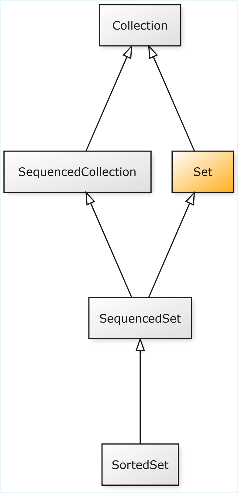

Em Java, conjuntos são representados pela interface `Set`, que define uma coleção que não permite elementos duplicados. Isso é útil quando se deseja garantir a unicidade dos itens armazenados, como em listas de usuários únicos ou códigos distintos. A interface `Set`[^1] (Conjunto) fornece uma abstração para conjuntos matemáticos. A figura abaixo mostra a inteface `Set` e suas interfaces relacionadas.



Desta forma, instâncias de classes que implementem `Set` não podem conter elementos duplicados (considerando o método `equals` para verificar tal duplicação) e podem conter no máximo um elemento nulo. Sendo um tipo mais específico que `Collection`, `Set` coloca restrições nos contratos dos construtores (em relação a duplicatas) e dos métodos `add`, `equals` e `hashCode`.

As implementações mais comuns de `Set` incluem `HashSet`, que oferece alto desempenho e não garante ordem; `LinkedHashSet`, que mantém a ordem de inserção; e `TreeSet`, que mantém os elementos ordenados de forma natural ou com um comparador personalizado. Os conjuntos são amplamente utilizados em operações matemáticas como união, interseção e diferença.

Não há também previsão acerca de uma ordem dos elementos (embora um implementador possa o fazer). Desta forma, por exemplo, os métodos `iterator` e `toArray` retornam os elementos em uma ordem não especificada. Poderíamos, por exemplo, criar um conjunto com as estações do ano, usando a classe `HashSet` ou outra classe que implemente a interface `Set`:


```java
void main() {
    Set<String> estacoes = new HashSet<>();
    estacoes.add("Primavera");
    estacoes.add("Verão");
    estacoes.add("Outono");
    estacoes.add("Inverno");
}
```


Além dos métodos herdados de `Collection`, `Set` adiciona ainda alguns métodos fábrica para a criação de conjuntos imutáveis, seja a partir de parâmetros, seja através de uma coleção passada como parâmetro. Há doze métodos `of`, um para o conjunto vazio, um para cada número de parâmetros de um a dez elementos[^2], e um para *n* elementos:


```java
public interface Set<E> extends Collection<E> {
    static <E> Set<E> of() {
        return (Set<E>) ImmutableCollections.EMPTY_SET;
    }
    static <E> Set<E> of(E e1) {
        return new ImmutableCollections.Set12<>(e1);
    }
    static <E> Set<E> of(E e1, E e2) {
        return new ImmutableCollections.Set12<>(e1, e2);
    }
    // E assim sucessivamente até o método fábrica para 
    //dez elementos.
    
    // E ainda o método para n elementos
    static <E> Set<E> of(E... elements) {...}   
    
    // E o método para criar um conjunto
    // a partir de uma coleção
    static <E> Set<E> copyOf(Collection<? extends E> coll) {...}
}
```


Tais métodos criam conjuntos imutáveis, ou seja, que não podem ser modificados após a criação (adição, remoção, etc). Caso sejam fornecidos elementos duplicados para o método `of`, é lançada uma exceção (do tipo `IllegalArgumentException`[^3]).

Por exemplo, poderíamos criar um conjunto imutável contendo as estações do ano usando o método `of`:


```java
void main() {
    Set<String> set = Set.of("Primavera", "Verão",
                             "Outono", "Inverno");    
}
```


De forma análoga, poderíamos criar um conjunto imutável a partir de uma lista de estações (no exemplo foram omitidos os tipos através do uso de `var`):


```java
void main() {
    var list = List.of("Primavera", "Verão", 
                       "Outono", "Inverno");
    var set = Set.copyOf(list);    
}
```


Caso existam elementos nulos ou duplicatas, é lançada uma exceção (do tipo `NullPointerException`[^4] ou `IllegalArgumentException`, respectivamente).

São descendentes importantes de `Set` as interfaces `SequencedSet`, `SortedSet` e `NavigableSet`.

`SequencedSet`[^5] é uma interface introduzida no Java 21 como parte do pacote `java.util`. Ela representa um conjunto (estende `Set`) com ordem sequencial previsível, ou seja, mantém uma ordem definida de elementos únicos (estende `SequencedCollection`). A interface define, adicionalmente aos métodos das superinterfaces, um método `reversed`, que fornece uma visão invertida do conjunto. A única diferença em relação ao método `reversed` de `SequencedCollection` é o tipo de retorno (que é `SequencedSet`).

A interface `SortedSet`[^6] especifica um conjunto ordenado de elementos. Os elementos são ordenados pela ordem natural dos elementos ou através de um `Comparator` informado na criação do conjunto. Desta forma, os elementos devem ser comparáveis (normalmente implementando `Comparable`). Ela estende `SequencedSet`, adicionando métodos para tratar de elementos ordenados incluindo métodos para obtenção do início (`first`) e fim do conjunto (`last`), para obtenção de intervalos dentro do conjunto (`subSet`, `headSet`, `tailSet`) e para acesso ao comparador (`comparator`), além de outras funcionalidades.

A interface `SortedSet` foi estendida no Java 6 pela interface `NavigableSet`[^7]. E ambas as classes do framework de coleções que implementam `SortedSet` o fazem indiretamente, ao implementarem `NavigableSet`. Então, na prática, faz mais sentido usar `NavigableSet` do que `SortedSet` diretamente. Tanto `ConcurrentSkipListSet`[^8] quanto `TreeSet`[^9] são classes que implementam `NavigableSet`. `NavigableSet` adiciona algumas funcionalidades para navegação, como os métodos para busca de elementos (`lower`, `floor`, `ceiling` e `higher`), métodos para a remoção de elementos (`pollFirst` e `pollLast` - remoção do primeiro e do último, respectivamente) e uma visualização inversa do conjunto (chamando `descendingSet` ou `reversed`), bem como dois iteradores (`iterator` e `descendingIterator`).

[^1]: Para a documentação da interface `Set`:\
    <https://docs.oracle.com/en/java/javase/25/docs/api/java.base/java/util/Set.html>

[^2]: Teoricamente, apenas o método `of` sem parâmetros, para conjuntos vazios e o método of com argumentos variáveis (*varargs*) seriam suficientes. No entanto, por questões de desempenho e para evitar a criação de um vetor temporário de argumentos mesmo no caso de conjuntos pequenos, os projetistas da API forneceram alguns métodos fábrica para os casos mais comuns de conjuntos pequenos (um a dez elementos).

[^3]: <a href="https://docs.oracle.com/en/java/javase/25/docs/api/java.base/java/lang/IllegalArgumentException.html" class="uri"><code>https://docs.oracle.com/en/java/javase/25/docs/api/java.base/java/lang/IllegalArgumentException.html</code></a>

[^4]: <a href="https://docs.oracle.com/en/java/javase/25/docs/api/java.base/java/lang/NullPointerException.html" class="uri"><code>https://docs.oracle.com/en/java/javase/25/docs/api/java.base/java/lang/NullPointerException.html</code></a>

[^5]: <https://docs.oracle.com/en/java/javase/25/docs/api/java.base/java/util/SequencedSet.html>

[^6]: <https://docs.oracle.com/en/java/javase/25/docs/api/java.base/java/util/SortedSet.html>

[^7]: <https://docs.oracle.com/en/java/javase/25/docs/api/java.base/java/util/NavigableSet.html>

[^8]: <https://docs.oracle.com/en/java/javase/25/docs/api/java.base/java/util/concurrent/ConcurrentSkipListSet.html>

[^9]: <https://docs.oracle.com/en/java/javase/25/docs/api/java.base/java/util/TreeSet.html>

## Referências cruzadas

- [Interfaces e o framework de coleções](/interfaces-framework-colecoes/)
- [Coleções, iteradores e listas](/colecoes-iteradores-listas/)
- [Filas e deques](/filas-deques-java/)
- [Links](/links-colecoes-java/)
- [Exercícios](/exercicios-colecoes-java/)
- [Mapas](/mapas-em-java/)

*Este artigo adapta conteúdo do livro [Orientação a Objetos com Java](https://www.amazon.com.br/dp/B0FWZ6HYVP), de Eduardo Kessler Piveta.*
