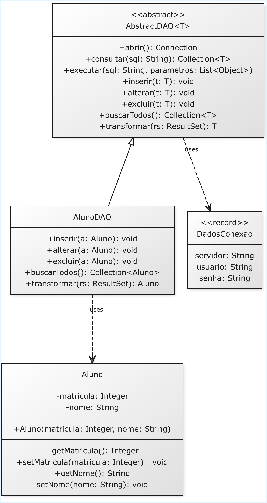

<!-- DAO_CONTEXT_START -->
**Contexto:** A superclasse generaliza a infraestrutura da [primeira implementação de AlunoDAO](/aluno-dao-crud-java/)primeira implementação de AlunoDAO.
<!-- DAO_CONTEXT_END -->

Quando uma aplicação precisa persistir várias entidades, copiar a mesma lógica de conexão, criação de sentenças e leitura de resultados em cada DAO produz repetição. O capítulo usa herança, classes abstratas e tipos genéricos para reunir essas tarefas em `AbstractDAO<T>`. O parâmetro `T` representa o tipo de objeto manipulado por uma subclasse concreta.

<figure style="max-width: 540px; margin: 1.5rem auto;">
  
  <figcaption>Hierarquia de classes do DAO genérico apresentada no livro.</figcaption>
</figure>

A classe do livro utiliza estas importações:

```java
import java.sql.Connection;
import java.sql.DriverManager;
import java.sql.ResultSet;
import java.sql.SQLException;
import java.util.ArrayList;
import java.util.Collection;
import java.util.List;
```

A implementação completa apresentada no livro é:

```java
public abstract class AbstractDAO<T>{
    public Connection abrir() throws SQLException{ 
        var data = new DadosConexao();
        return DriverManager.getConnection(
            data.servidor(), data.usuario(), data.senha());
    }
    
    public void executar(String sql,
                         List<Object> parametros){
       try (var conexao = abrir(); 
            var ps = conexao.prepareStatement(sql)){
            int count = 1;
            for (Object p : parametros) 
                ps.setObject(count++, p); 
                ps.execute(); 
        } catch (SQLException e){
            e.printStackTrace();
        }
    } 

    public Collection<T> consultar(String sql){ 
        var retorno = new ArrayList<T>();
        try (var conexao = abrir(); 
             var s = conexao.createStatement(); 
             var rs = s.executeQuery(sql)){
            while (rs.next())
                retorno.add(transformar(rs));
        } catch (SQLException e){
            e.printStackTrace();
        }
        return retorno;
    } 
		
    public abstract void inserir(T t);
    public abstract void alterar(T t);
    public abstract void excluir(T t);
    public abstract Collection<T> buscarTodos();
    protected abstract T transformar(ResultSet rs);
}    
```

`abrir()` obtém uma conexão com os valores do `record` `DadosConexao`: URL `jdbc:postgresql://localhost:5432/academico`, usuário `postgres` e senha `postgres`. `executar()` recebe a SQL e uma lista de parâmetros, cria um `PreparedStatement` e usa `setObject` para cada parâmetro, pois a superclasse não conhece antecipadamente seus tipos específicos.

`consultar()` recebe uma consulta SQL, cria um `Statement`, percorre o `ResultSet` e reúne objetos em uma coleção. Para transformar cada linha em `T`, chama `transformar(rs)`. Esse método é abstrato: a subclasse sabe como construir um objeto da entidade a partir dos dados da linha.

Também são abstratos `inserir`, `alterar`, `excluir` e `buscarTodos`. A superclasse oferece a infraestrutura comum, mas cada DAO concreto deve definir as operações e a conversão específicas de sua entidade. Os recursos são declarados em `try` com recursos, enquanto os blocos `catch` do exemplo apenas imprimem o *stack trace* das falhas SQL.

<!-- DAO_RELATIONS_START -->
## Artigos relacionados

- [Criando AlunoDAO com operações CRUD](/aluno-dao-crud-java/) — implementação inicial do DAO.
- [Um record para os dados de conexão JDBC](/dados-conexao-record-java/) — valores da conexão JDBC.
- [AlunoDAO herdando de AbstractDAO<Aluno>](/aluno-dao-heranca-java/) — DAO após a herança.

Em outro idioma: [Versão em inglês](/en/abstractdao-a-generic-data-access-superclass/).
<!-- DAO_RELATIONS_END -->

---

*Este artigo adapta conteúdo do livro [Orientação a Objetos com Java](https://www.amazon.com.br/dp/B0FWZ6HYVP), de Eduardo Kessler Piveta.*
