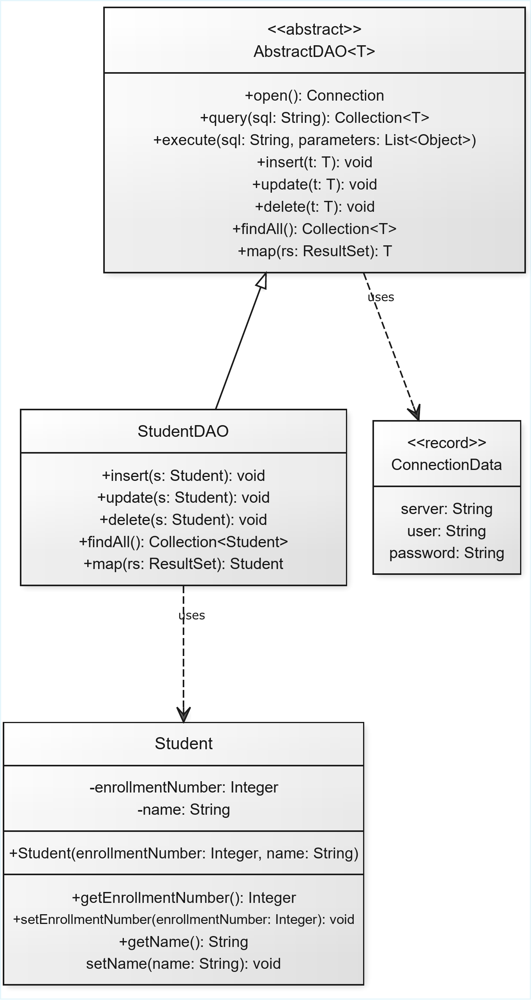

如果每种实体都有独立DAO，打开连接和读取结果的代码容易重复。本章将公共机制集中在`AbstractDAO<T>`中。类型参数`T`表示由具体子类确定的对象类型。

<figure style="max-width: 540px; margin: 1.5rem auto;">
  
  <figcaption>书中的AbstractDAO、StudentDAO、Student和ConnectionData类层次图；标签与英文代码一致。</figcaption>
</figure>

书中使用的import如下：

```java
import java.sql.Connection;
import java.sql.DriverManager;
import java.sql.ResultSet;
import java.sql.SQLException;
import java.util.ArrayList;
import java.util.Collection;
import java.util.List;
```

以下为使用英文标识符的完整实现：

```java
public abstract class AbstractDAO<T>{
    public Connection open() throws SQLException{ 
        var data = new ConnectionData();
        return DriverManager.getConnection(
            data.server(), data.user(), data.password());
    }
    
    public void execute(String sql,
                         List<Object> parameters){
       try (var connection = open(); 
            var ps = connection.prepareStatement(sql)){
            int count = 1;
            for (Object p : parameters) 
                ps.setObject(count++, p); 
                ps.execute(); 
        } catch (SQLException e){
            e.printStackTrace();
        }
    } 

    public Collection<T> query(String sql){ 
        var result = new ArrayList<T>();
        try (var connection = open(); 
             var s = connection.createStatement(); 
             var rs = s.executeQuery(sql)){
            while (rs.next())
                result.add(map(rs));
        } catch (SQLException e){
            e.printStackTrace();
        }
        return result;
    } 
		
    public abstract void insert(T t);
    public abstract void update(T t);
    public abstract void delete(T t);
    public abstract Collection<T> findAll();
    protected abstract T map(ResultSet rs);
}    
```

`open()`借助`ConnectionData`建立连接。`execute()`接收SQL和参数；由于父类不知道具体类型，它通过`setObject`设置参数值。`query()`遍历`ResultSet`，对每行调用`map(rs)`以收集`T`类型的对象。

`map`、`insert`、`update`、`delete`和`findAll`是抽象方法，须由具体DAO实现。资源由try-with-resources管理；示例的`catch`输出SQL异常的堆栈信息。

<!-- DAO_RELATIONS_START -->
## 相关文章

- [创建具有CRUD操作的StudentDAO](/zh/building-studentdao-with-crud-operations/)
- [使用record保存JDBC连接数据](/zh/a-record-for-jdbc-connection-data/)
- [继承AbstractDAO<Student>的StudentDAO](/zh/studentdao-extending-abstractdao-student/)

英文版: [英文文章](/en/abstractdao-a-generic-data-access-superclass/).
<!-- DAO_RELATIONS_END -->

---

*本文改编自 Eduardo Kessler Piveta 所著的 [Orientação a Objetos com Java](https://www.amazon.com.br/dp/B0FWZ6HYVP)。*
